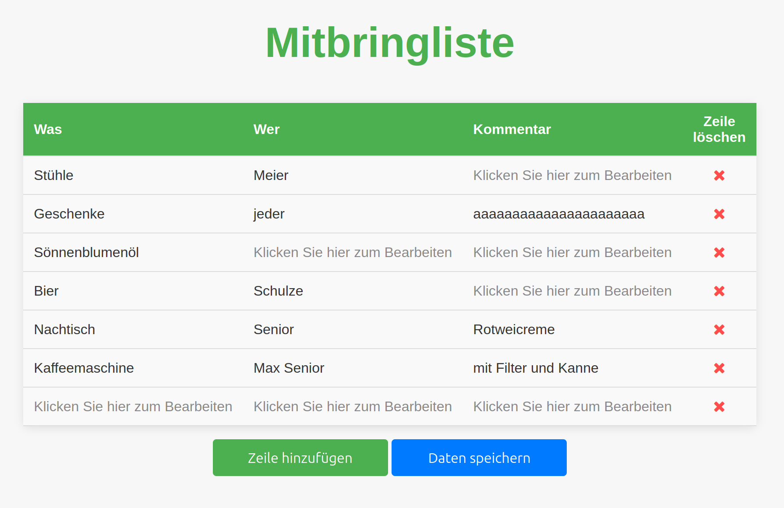

# 🪑 Table – Manage Items for a Party

**Table** is a simple and lightweight web app to coordinate what people bring to a party – like food, drinks, or other supplies. It allows anyone to add or remove items from a shared list.



> ⚠️ **Note:** This app has **no built-in authentication or access control**. It is intended for trusted environments. If you plan to deploy it online, set up a reverse proxy with HTTPS and access restrictions.

---

**Author:** [redcluster](https://github.com/redcluster)  
**License:** [GNU GPLv3](https://www.gnu.org/licenses/gpl-3.0.en.html)  
**Dates:** 04–05.12.2024, 20.10.2025, 30.04.2026

---

## 🧩 Dependencies

- Base image: `python:3.13-alpine` (via Dockerfile)
- Python packages: listed in `requirements.txt`
- Icons: [Font Awesome](https://fontawesome.com) (MIT License)

---

## 🛠️ Development

### 🔧 Run Locally

Install required packages (Debian-based):

```bash
sudo apt install python3-flask python3-requests
```

start app:
`python3 app.py`

Access it at: http://localhost:5000

### 🐳 Run with Docker/Podman

1. Update base image:
`podman pull docker.io/library/python:3.13-alpine`

2. Build the container:
`podman build -t table-app .`

3. Run the container:
```bash
mkdir ~/data
podman run -d -p 5000:5000 -v ~/data:/app/data:z --name "table-app" localhost/table-app:latest
```

Hint: Ensure correct volume access rights for `~/data`. On my installation the id of the user running the app is 100999. Easy way to find out user id: 
1. `chmod 777 ~/data` 
2. delete `~/data/table.json`
2. write table data to create new `table.json` file by application 
3. check id of `table.json` file
4. set folder access rights (here for user with id 100999): `chown 100999:100999 data/`

Optional: export the container image to file:
`podman save -o table-app.tar.gz table-app:latest`

### 📦 Upload to GitHub Container Registry

1. Generate a classic token: https://github.com/settings/tokens (delete:packages, repo, write:packages)

2. Login to GitHub Container Registry:
```bash
export CR_PAT=ghp_xxx
echo $CR_PAT | podman login ghcr.io -u USERNAME --password-stdin
```

3. Tag and push image:
```bash
podman tag localhost/table-app:latest ghcr.io/redcluster/table-app:latest`
podman push ghcr.io/redcluster/table-app:latest
```

4. review: https://github.com/users/redcluster/packages/container/package/table-app

### Compose file for dockge

Hint: I'm using caddy on network named `web` to access table-app.

```yaml
services:
  table-app:
    image: ghcr.io/redcluster/table-app:latest
    container_name: table-app
    restart: unless-stopped
    networks:
      - web
    volumes:
      - ./data:/app/data
networks:
  web:
    name: web
    external: true
```
